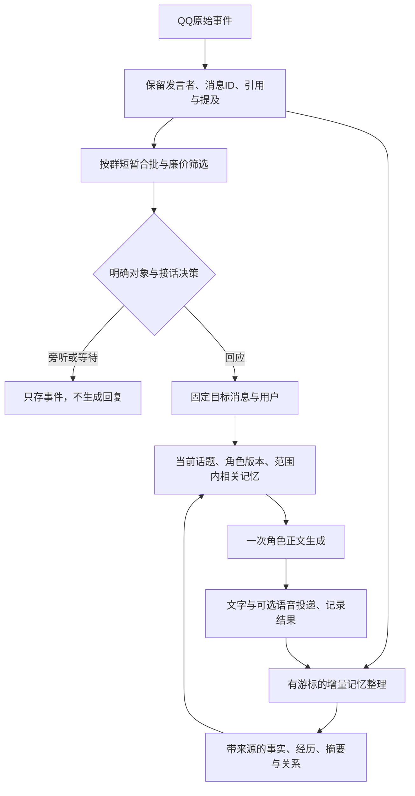

# qq-bot-miyako 优化分析

研究日期：2026-10-23（Asia/Shanghai）。阅读范围、提交与行号索引见 [证据记录](02_证据与核验记录.md)。本文区分三种结论：源码可以确定的行为、隔离方法探针观察到的行为，以及需要真实群聊验证的设计建议。

## 1. 总体判断：保留底座，优先修四个交接点

这个项目已经有较好的轻量基础：角色卡从六千多字符缩减到当前 1537 字符；原生随机插话在复现配置中关闭，由意愿插件接管；使用官方请求和响应钩子；有画像条数/注入长度上限、原子替换 JSON、管理员权限装饰器、媒体缓存和诊断工具。隐私数据目录也已加入 `.gitignore`。

主要短板集中在四个交接点：**平台消息到评分器丢失对话关系，群聊到记忆库丢失身份范围，历史压缩到后续轮次丢失摘要，角色卡到评分/知识提示缺少统一版本。**应先补这些边界。

当前看不出必须更换 AstrBot 的理由。你指定的资料也主张先定位现有实现，再用同一组对话比较局部改进。为此项目引入完整 DSH 运行时、图记忆或多个 Agent，会先增加维护和调用成本。

建议的最小链路如下。图中组件可以先在现有插件中分函数实现，不要求拆成多个服务或每一步都调用模型。



## 2. 意图识别：首先解决“这句话对谁说”

### 2.1 当前能确定的原因

**上游限流可能先让机器人看不全对话。**复现配置是同会话 60 秒 10 次、超出丢弃。发布标签源码中的 RateLimitStage 位于插件处理前，按进入流水线的事件记账；通用平台消息处理器会让普通群消息也进入该路径。因此这不是 README 所说的“每分钟最多回复十条”：即使前十条都没生成回答，第十一条也可能在群上下文、意愿门控和记忆观察之前被丢弃。隔离限流探针验证了 11 条事件、0 条回复时第 11 条被截断。

这应列为第一批核查项，尤其是活跃群。实际部署若同样使用模板值，应把入站观察预算与出站发言预算分开，先保证可见语境完整，再限制机器人开口；不能靠丢失大量上下文来实现防刷屏。当前仓库不含线上配置，所以本轮确认的是模板与发布标签组合的行为。

**评分器拿到的信息不足。**`willingness_gate` 的窗口行只有昵称、时分和前 80 字。它没有保存稳定 sender ID、message ID、Reply 的原作者/目标、At 的目标或话题归属。[门控窗口源码](https://github.com/kasuganosora147258/qq-bot-miyako/blob/4cd1eb5cd0bb1da451a905e3a8a0481f50d9c55c/local/AstrBot/data/plugins/willingness_gate/main.py#L90)

`@`/唤醒消息又在入窗前被跳过，机器人自己的回复也不进入这个窗口。因此它可能看见一串普通发言，却看不见造成这些发言的机器人问句或明确点名。评分提示要求判断“她刚说过话”“两个人正在连贯聊天”，输入却缺少完成判断的重要材料。

**提及名字被当成直接寻址。**包含“小都”等字符串时 `_evaluate()` 直接返回 10。例如甲向乙说“小都昨天说过这个”，并不等于甲正在请机器人回应。隔离探针确认这类转述也会直接满分。名字子串只能是线索，不能直接代表对话对象。[满分路径](https://github.com/kasuganosora147258/qq-bot-miyako/blob/4cd1eb5cd0bb1da451a905e3a8a0481f50d9c55c/local/AstrBot/data/plugins/willingness_gate/main.py#L143)

**一个“接话价值分数”承担了多个不同判断。**现在输出一个整数，没有给出“向机器人说、向别人说、公开讨论、转述、未知”的区分，也没有确定要回复哪条消息。生成阶段收到的核心 prompt 仍是当前文本；上游评分判断无法以明确目标传递下去。

**需要收紧一个常见误诊：主模型并非完全没有身份信息。**复现配置的 `identifier=true`，AstrBot 发布标签中的主链会补当前用户 ID/昵称，也处理引用文本；群上下文能呈现 @ 和引用的显示信息。但这些信息并没有自动进入自定义评分窗口和画像记录，历史展示也不等于完整的结构化人物关系图。因此问题是信息在不同路径中不一致，不能笼统说 AstrBot 完全不支持区分发言人。

### 2.2 常规工程建议

先保留最小消息结构：

```json
{
  "platform_instance_id": "qq-account-A",
  "conversation_id": "group-100",
  "message_id": "m103",
  "sender_id": "u17",
  "display_name": "甲",
  "timestamp": "2026-10-23T16:00:00+08:00",
  "mention_user_ids": ["u23"],
  "reply_to_message_id": "m101",
  "reply_to_sender_id": "u23",
  "text": "那你明天几点到？"
}
```

这些可信字段来自平台适配器。昵称、正文里自称的“我是某某”和用户伪造的 JSON 都不能改写真实身份字段。

接着拆成三个判断：

1. **对象**：对机器人、对某群友、公开讨论，还是未知？显式引用/@ 的 ID 优先；普通昵称、代词和语义作为补充。多重提及冲突时保留不确定性。
2. **参与**：被直接询问通常回应；别人在对话通常旁听；公开讨论可以适度参与；不确定时允许等待。参与频率与对象置信度分开。
3. **表达**：把已选目标、对方问题、必要事实和角色要求交给主模型，生成一段回复。

规则先处理显式关系，只有模糊情况才用短模型请求；不必让每条消息都先走完整 Planner。模糊决策可使用下面的内部结果，字段是设计示例，不是当前 API：

```json
{
  "addressing": "other_user",
  "target_message_id": "m103",
  "target_user_id": "u17",
  "action": "observe",
  "evidence_message_ids": ["m101", "m103"]
}
```

`target_user_id` 在选择回应时代表机器人要回应的那个人；`addressing` 则描述输入原本面向谁，两者不能混用。程序校验目标真实存在且属于当前群，模型只可选择当前范围内的 ID。

为当前群维护一小份对话状态：最近机器人问了谁、谁尚未回应、当前话题及最后回复目标。甲回答机器人问句时，乙刚插入一句无关话，不应把甲的答案套到乙身上。窗口既要包含被点名消息，也要包含已确认发送的机器人发言。

同一人连续补句可先测试约 1–2 秒短合批，并设总等待上限；具体参数由回放确定。发送前再检查是否已有新消息、更正或目标被撤回。需要回应较早消息时，生成材料中的“当前对话对象”和实际引用都绑定已选目标，不能仍沿用触发事件中最新用户的身份。

复现配置同时关闭了 `reply_with_quote` 和 `reply_with_mention`。群里有并行话题时，建议对歧义较大的回复使用平台引用，帮助群友也辨认回应对象；无需每句都 @。

### 2.3 资料如何用于本项目

[02a 麦麦深入拆解](../框架架构与运维研究_2026-10-22/02a_MaiBot_人设上下文记忆与发言决策详解.md)中的可取之处是门控、等待、目标消息与 Replyer 的职责分工。对本项目，先借鉴“廉价筛选＋必要时语义判断＋明确目标”，不必复制完整的双模型工具循环，也不宜照搬上游群聊拟合权重。

[08 whale 报告](../框架架构与运维研究_2026-10-22/08_whale-notify_渠道整合与身份隔离分析.md)提醒：会话路由、引用对象和记忆过滤是三个独立环节。此项目原本通过事件发送回原群，不能把 whale 的具体串群缺陷直接归给它；这里更直接的问题是回复对象不明确及记忆内容可能越界。

### 2.4 两个伴随问题

门控在等待评分前检查冷却，评分结束后才更新 `_last_speak`。同群两条消息并发时可以一起通过检查；隔离探针得到两次请求。AstrBot 主模型锁能串行生成，却不能撤销前面已经做出的两个接话决定。建议加按群的评分/决策占用状态，合并待处理消息，发送后再统一更新冷却。

目前直接 @ 走核心主链，不更新该插件的 `_last_speak`。因此“刚回答过 @，又主动插话”仍可能发生。应区分“上次实际发言”“上次主动发言”“下次允许评分”的时刻；失败评估也要有短暂退避和调用预算。

## 3. 记忆整理：先保证留下、归属正确、纠正生效

### 3.1 当前最应先修的缺陷

| 问题 | 源码表现 | 后果 |
| --- | --- | --- |
| 多群和多人身份混合 | 所有群共用 `_pending`/`lines.jsonl`；记录仅 t/name/text；`profiles[name]` | 同名用户被合并，改名后可能变成另一个人，来源群无法恢复 |
| 注入没有范围过滤 | `_inject_profiles()` 不依据 event 的群、私聊或当前人物筛选 | 群 A 画像可进入群 B，甚至其他用户的私聊请求；探针已验证方法行为 |
| 已存摘要后续不恢复 | `len(ctx)<=40` 立即返回；注入只在新摘要生成成功时执行 | 第一次压缩带摘要，下一普通轮没有摘要；探针验证 1→0 次注入 |
| 未达阈值也清空 | 每半小时先取走并清空 pending，再检查是否至少 15 条 | 安静群每次少量新材料可能一直进不了画像 |
| 失败和超长批次丢失 | 请求失败/解析失败直接返回；只提交批次开头 8000 字符 | 尾部未处理材料和失败材料没有重试游标 |
| 重启不能续提炼 | pending 只在内存，启动不从 lines 恢复消费位置 | 文件里有记录，不等于重启后会继续整理 |
| 纠错材料不全 | 提炼请求只看本批聊天，不带目标人物的旧事实 | 难以知道该替换哪条旧记忆 |
| 删除范围不完整 | 管理命令只改画像事实字符串 | 旧摘要、当前历史和待提炼材料仍可能使错误复活 |

核心定位见 [记忆插件](https://github.com/kasuganosora147258/qq-bot-miyako/blob/4cd1eb5cd0bb1da451a905e3a8a0481f50d9c55c/local/AstrBot/data/plugins/memory_distill/main.py#L117)。这些问题在引入 embedding 前就应解决。

此外，按 v4.29.1 命令过滤逻辑，命令名只在过滤器的局部变量中去掉，`event.message_str` 仍含“都记忆/都忘掉”。当前两个管理方法把它整体当参数：查看可能把“都记忆”当昵称，删除可能把“都忘掉”当目标人。源码对照与隔离方法探针均支持这一缺陷。应使用框架显式解析的参数或明确去掉命令名，并优先按用户 ID/记忆 ID 操作。

### 3.2 最小可维护的数据模型

单实例可先用 SQLite，不必马上加外部服务。最低需要这些记录：

- **消息事件**：平台实例、群/私聊、message ID、sender ID、原文、引用/提及、事件时间；用于追溯和重放。
- **事实**：主体 ID、属性、值、来源消息、可见范围、状态、有效时间、被哪条新事实替换。昵称作为显示别名。
- **经历**：何时、哪些参与者、确实发生了什么、有没有未完成约定；与人物偏好分开。
- **会话摘要**：会话 ID、覆盖到哪个消息游标、摘要版本与内容；每轮恢复已保存摘要，压缩按需更新。
- **角色与关系状态**：角色定义版本，以及对不同用户的称呼/互动习惯等；保留变更依据。

第一版范围键至少是 `platform_instance + conversation/audience + persona_id + subject_user_id`。同一个 QQ 用户在不同群是否共享某项信息，需要显式策略；默认先不共享。没有多角色或分支需求时，不必一次建设完整的世界/剧情版本系统。

事实可以具有下面的示意字段：

```text
memory_id, subject_user_id, predicate, value,
audience_scope, source_message_ids, source_kind,
event_time, learned_at, valid_from, valid_to,
status(active/superseded/retracted), supersedes, version
```

“模型有把握”和“用户明确说过”是两件事，不能用一个置信度分数替代来源。转述、玩笑、假设、角色台词与真实自述需要不同类型。

### 3.3 整理与召回怎样改

**整理采用“成功后确认消费”**：新增事件持久保存 → 按范围取未处理批次 → 分块提炼 → 校验主体与来源 → 事务写事实和游标。少于阈值继续累积，失败保留待办并退避；超长材料分块推进，不能取前 8000 字后当整批完成。停止时保留消费位置。

**摘要恢复与摘要生成拆开**：每次生成前先读取已有累计摘要；达到预算时才生成新版本。新版本综合已有摘要和新增片段，保留来源范围，不用简单字符串拼接后截尾。失败时保留旧摘要与可重试材料。原始对话归档与模型窗口裁剪分别处理。

不能直接按任意 `ctx[-20:]` 切工具协议链。AstrBot 历史可以包含 checkpoint、工具调用和结果，条目数量也不等于普通对话轮数。应按完整轮次/工具单元和 token 预算切分，与核心压缩明确职责，避免同时维护两套互不知情的裁剪器。

**召回先范围过滤，再相关性排序**：优先当前发言者、被引用者和选定回复对象；再用话题检索共同经历。当前按更新时间给所有人各塞最近四条，800 字满了就停，容易把空间用在不在场的人身上。“新”不能替代“和这句话相关”。

起步可以采用 CJK bigram/BM25 或小规模关键词索引；需要更好的同义表达召回时再比较 embedding。不要先上向量库，再让全局昵称画像继续污染检索。

**纠正通过结构化替换生效**：例如用户明确说“我不再喝咖啡，只喝茶”，新事实应关联具体旧事实并使其失效；“原以为：某关键词”无法保证命中正确旧项。更正后刷新派生画像、摘要引用和已缓存的检索结果。删除也应添加撤销/抑制记录，防止旧待办再次提炼回来。

机器人输出要区分“生成了”“已送达”“对方确认了”。现在 `observe_bot` 在 LLM 响应时记录，早于最终语音、图片装饰和平台发送。可以保存生成记录，但只有有投递结果的发言才适合形成“我们确实说过”的共同经历；虚构的“今天店里来了客人”也不应变成现实用户事实。

### 3.4 资料取舍

| 资料 | 借鉴到本项目的内容 | 不宜直接推导的能力 |
| --- | --- | --- |
| [04 meow-memory](../框架架构与运维研究_2026-10-22/04_dsh-meow-memory_分层记忆与恢复分析.md) | 稳定身份快照、相关召回、压缩后恢复、留痕 | 工作区共享分类并不等于多人权限隔离 |
| [05 Hindsight](../框架架构与运维研究_2026-10-22/05_Hindsight_长期记忆服务分析.md) | 原材料、抽取、归纳、检索分层；时间与来源；异步任务 | reflect 不会自动产生真实人格，bank 名称也不自动授予权限 |
| [01 综合报告中的 memory-board](../框架架构与运维研究_2026-10-22/01_综合结论与其他项目总结.md) | 用户可以查看、纠正、备份与回滚 | 面板存在不代表所有摘要和缓存都会同步失效 |
| [02a 麦麦](../框架架构与运维研究_2026-10-22/02a_MaiBot_人设上下文记忆与发言决策详解.md) | 来源消息、事实状态与查询/表达交接 | 上游也存在画像范围、自动冲突处理等限制，不能照搬后宣称全解决 |

本阶段建议 SQLite＋明确范围＋可靠增量整理。等真实样本显示大量跨天经历检索、时间查询与维护需求，再评估 Hindsight，比较命中质量、额外调用、备份和故障恢复负担。

## 4. 人格形成：核心稳定，关系与习惯可以有依据地变化

### 4.1 先消除当前提示冲突

当前角色卡写二十岁、短期大学二年级、温和拘谨、熟悉后露出小恶魔一面；评分提示写“傲娇小恶魔系女高中生，说话短、带刺”；设定速查又写白泉学园、同班同学、另一家咖啡店名。这里无需先争论原作考据，单看请求材料就已经不一致。

如果二十岁版本是主动改编，应明确这是当前角色的改编设定，知识卡保留“原作资料”标签并规定两者关系；如果要求遵循原作，就将角色卡与资料卡统一。评分器只需要同一份精简的行为设定，不应另写一套旧人设。TTS 的风格要求也从同一来源派生。

当前知识卡靠“动画”“能力”等宽词触发，命中后整卡注入。普通“最近看什么动画”并不一定需要整张作品设定卡；而“你爷爷的店叫什么”又可能不命中。建议把稳定身份关键点放到精简核心，将详细资料按主题拆块，再结合当前话题/指代检索。[知识卡逻辑](https://github.com/kasuganosora147258/qq-bot-miyako/blob/4cd1eb5cd0bb1da451a905e3a8a0481f50d9c55c/local/AstrBot/data/plugins/knowledge_card/main.py#L15)

### 4.2 区分五类东西

| 层 | 内容 | 更新方式 |
| --- | --- | --- |
| 核心角色定义 | 身份、背景、价值边界、基础表达 | 显式维护、版本化，不由日常摘要自由改写 |
| 用户事实 | 这个人明确自述的资料和偏好 | 有来源、可纠正、按范围召回 |
| 共同经历 | 约定、已发生互动、未完话题 | 保存时间、参与者和消息证据 |
| 关系/习惯 | 约定称呼、对方喜欢的互动方式 | 从多次独立互动提出候选，可撤销 |
| 短期情绪 | 刚发生争执、疲倦、当前不想聊 | 有时效，不直接固化为长期人格 |

不要把“记住群友二十条信息”当成人格已经成长。更有感受的连续性通常来自记住约定、知道对谁可以怎样开玩笑、发现被拒绝后减少追问，以及在相似情境中保持一致选择。

### 4.3 建议的成长闭环

真实互动 → 提取证据明确的经历/反馈 → 提出小范围习惯候选 → 检查是否冲突核心设定 → 接受或拒绝 → 在后续相似情境观察 → 可查看与回滚。

例如“乙明确说不喜欢被叫前辈，机器人后来两次遵守”可以形成对乙的称呼规则；“大家今天调侃她像女王”不应自动改成全局强势人格。重复引用同一条聊天不算多份独立证据。

可以先试“跨多次互动再产生候选”，无需规定一个神奇的好感度或三次必学阈值。涉及身份、背景和重要价值的改动由维护者决定；低风险称呼习惯可在证据和冲突检查后更新，保留来源、旧值、新值、原因、版本与回滚入口。

角色虚构日常可作为叙事状态保存，并检查时间连续性，避免上午说已关店、下一句又在上课。它应标记为虚构生活素材，不回流成用户现实资料或“工具已完成”的事实。

[DSH-Ling 在综合资料中的分层](../框架架构与运维研究_2026-10-22/01_综合结论与其他项目总结.md)支持“稳定人格受控、习惯可变化”的方向。建议借鉴治理思路，不把“人格树/反思”字样当作已经验证的成长效果。此项目第一步是统一提示与来源，不需要训练模型。

## 5. token：按完整交互计算，先减少无效工作

### 5.1 当前开销来自哪里

| 路径 | 当前实现 | 优化着力点 |
| --- | --- | --- |
| 意愿评分 | 非点名普通消息按 50% 抽样，最近 18 行×最多 80 字，使用当前聊天 provider | 规则先筛；模糊才评估；按群合批与调用预算 |
| 正文生成 | 人设、历史、群上下文、标识/时间、记忆、知识卡、工具等一起参与 | 分组件计量、相关召回、稳定前缀、限制工具回合 |
| 画像提炼 | 每半小时、达到阈值用当前 provider 读最多 8000 字符 | 分范围增量批次，独立任务模型；先修丢失再调频率 |
| 滚动摘要 | 条目超过 40 时额外调用当前 provider | 按预算压缩、稳定恢复；避免与内核压缩重复 |
| 日语台词 | 每次正文都附带日语；缺失时再次调用翻译模型 | 发言前决定本轮是否配音；文字请求可跳过台词生成 |
| 视觉 | 部分群图片先描述，视频最多逐帧三次描述 | 未回应消息的媒体预算、内容缓存、按需原生视觉 |
| 搜索/工具/重试 | 搜索开启、工具步数上限 128、主链重试配置 5 | 闲聊使用较小工具集；区分任务、重试和可见回复 |

“用同一个 API”不等于“不增加调用成本”，“输出一个数字”也不等于“评分很便宜”。当低分消息很多时，冷却只在成功准备主动回复后更新，评分仍可以持续发生。直接 provider 调用也绕过主角色请求钩子，应单独统计。

**临时注入仍计入本轮输入。**`mark_as_temp()` 在 AstrBot 中的语义是给 provider 看、持久化历史时过滤。画像每轮重新注入就每轮成为输入；只是避免重复存档后继续累加。知识卡命中时、TTS 格式提示和摘要也一样。源码注释中的“不烧 token”需要纠正。

### 5.2 先建立一份可解释的账

每次模型调用记录 `purpose、group/conversation、turn_id、provider/model、input/output/reasoning/cached tokens、latency、retry、status`。purpose 至少分 score、reply、summary、profile、voice_fallback、vision、search。记录供应商实际返回的 usage；缺失值应记为未知，不能记成 0。

每次生成再统计人设、历史、群上下文、画像、摘要、资料卡、工具定义各占多少输入。这样才能区分“角色卡太长”和“本来不该回复却做了两次请求”。不要用 `字符数×0.7` 当准确账单。

```text
一次有效互动的成本
  = 所有相关评分 + 正文/工具续轮 + 摘要/画像分摊
    + 语音翻译 + 视觉 + 搜索 + 失败与重试

模型费用
  = Σ[(未命中输入×单价 + 命中输入×单价 + 输出×单价) / 1,000,000]
    + 供应商按次收费项目
```

作为纯假设示例：1000 条“冷却外、可评分”的普通消息，50% 抽样约 500 次评分；若每次 800 输入＋1 输出，约 40 万 token。假设其中 50 次最终回复，每次 1800 输入＋100 输出，约 9.5 万 token。评分可能比正文占更多 token。这里没有采用真实群流量，不能作为本项目的实际成本或节省率。

### 5.3 推荐优化顺序

**第一，减少无效调用。**@别人、引用别人、明确通知等可以先走确定规则；有冲突才交给模型。门控同群仅保留一个运行中的评估，后续消息合批。限制每群每小时评分次数，预算紧张时旁听，同时保留直接找机器人的互动。

**第二，把记忆预算花给当前人和话题。**限制无关画像，不要固定注入所有最近更新的人。摘要每轮保持可用，但可以按当前问题召回更详细经历。token 超预算时，先裁无关材料，保护角色核心、目标消息与相关引用链。

**第三，按任务选择模型与输出预算。**评分、摘要、事实提取可以配置独立 provider，并用回放验证质量。短回复默认保留非思考路径；只对确实模糊的对象判断单独比较较强模型。不要全局开启重思考来弥补缺失的 ID 或引用。双语正文要给中文与日文一起留输出空间，过小上限会导致格式不全或空输出。

实验起点可先给正文总输入约 3k–6k token 的软预算、输出约 200–400 token；复杂工具查询单独设预算。它们是待调参数，必须用实际 tokenizer/usage 和双语完成率校准。结构化对象决策也需要足够的输出空间，不能沿用“一位数字”的上限。

**第四，利用缓存，但以实际命中为准。**稳定角色定义和工具顺序置前，时间、当前消息、动态关系等变化材料置后；不要把每分钟变化的信息插到稳定长前缀前面。DeepSeek 官方说明缓存依赖已落盘的前缀单元完整匹配，且是尽力而为；应读取 hit/miss 字段，不能承诺每次命中。[官方缓存规则](https://api-docs.deepseek.com/zh-cn/guides/kv_cache/)

不要为了少几个 token 频繁重排全部历史，反而破坏可复用前缀；也不要为了缓存让无关历史无限膨胀。比较质量、实际费用和延迟三项。

**第五，控制媒体与工具。**`VOICE_RATE` 目前在正文日语已经生成、必要时兜底翻译之后才抽样；降低这个值并不能同比减少语言模型开销。应在请求前决定本轮是否要语音。图片缓存使用 URL、视频使用路径摘要，缓存键还应考虑内容、模型和提示版本；共享在途请求，避免同一媒体同时被重复描述。

普通群聊可试把工具步数上限从 128 收紧到 4–8，具体工具请求再放宽。网络错误重试、格式重试和工具副作用分开，不应整轮反复执行；预算应覆盖 provider 自身的内部重试，不能只数主链配置中的 5。

### 5.4 时效资料带来的新增机会

仓库多处写“DeepSeek 是纯文本模型”。本次联网核对，2026-10-23 官方模型表已将 `deepseek-flash` 列为支持图像理解，当前版本为 V4.1-Flash-1017；9 月发布说明也明确其原生多模态能力。这使“直接让主模型看必要图片”成为值得比较的备选。[官方模型表](https://api-docs.deepseek.com/zh-cn/quick_start/pricing/)、[发布说明](https://api-docs.deepseek.com/zh-cn/news/news260910/)

这不代表当前项目只需换一句配置：复现配置 `modalities=[]`，还有描述插件、引用图片、fallback 与费用处理需要一起验证。也不保证原生视觉总比独立描述便宜。应比较“廉价描述＋正文”和“候选通过后主模型直接看图”的理解质量、调用次数和完整成本。

当前官方价格表使用人民币，并区分工作日高峰、空闲时段及节假日；README 的美元估值和未说明流量的月费不能当作当前预算依据。本报告保留计算方法，不给出未经 usage 支持的月费承诺。[当前计价依据](https://api-docs.deepseek.com/zh-cn/quick_start/pricing/)

## 6. 其他值得提出的问题

### 6.1 插话配置与文档已分成两套

复现配置 `active_reply.enable=false`，意愿插件不读该开关、原生概率或原生主动白名单。README 仍把这些字段作为控制插话的主要入口，会使“改了配置却没变化”。平台总白名单仍是另一层，应区分。

图片插件的纯图主动回复分支却要求 `enable_active_reply=true`；而意愿插件遇空文本直接退出。因此默认组合下，未被 @ 的纯图消息不能依赖文档中原来的随机接话路径。@ 图和图作为后续上下文是另外两条路径，不应混为“所有看图都坏了”。

建议统一一个参与策略入口，由它管理启停、白名单、文本/媒体、冷却、频率和预算；文档据实际生效字段重写。

### 6.2 媒体补丁的生命周期与可靠性

`caption_filter` 导入时全局替换 AstrBot 四个方法，未提供对应的退出恢复。插件禁用/重载应验证补丁是否还生效、是否重复包装；版本兼容检查应覆盖实际函数接口。能迁移到正式扩展钩子的部分优先迁移。不要把“出现错误只打日志”当作已证明所有上游变更都会安全降级。

表情包库是全局池，发送按使用次数和随机选择，没有话题、情绪和来源群约束。随机附图可能与安慰、严肃讨论冲突，也可能把某群图片带到另一个群。可先按群隔离并加入场景禁发，再考虑少量情绪标签；无需每次用视觉模型选图。

### 6.3 复现配置应重新生成认证材料

公开模板包含固定的 Dashboard 密码派生材料及 JWT 签名材料，初始化主要替换本机路径，没有为新实例生成新的认证材料。即使文字密码字段写的是占位值，也不能推断已有 hash 和签名配置已经换新。

建议首次初始化生成新材料并要求设置自己的管理员身份；管理入口默认仅本机可达。这里确认的是公开模板与初始化行为，不代表已验证正在运行的服务使用这些值，也没有尝试访问服务或使用其中材料。

### 6.4 数据维护和备份仍需覆盖插件

`_trim_lines_file()` 有定义但没有调用，原始记录文件不会因声明 `LINES_MAX=2000` 就自动受限。建议设置真实轮转与保留期，同时保留必要来源索引。重启恢复要检查待提炼游标，而不仅是进程能起来。

`apply_persona.py` 直接复制主 SQLite 文件作为 `.bak`。在 WAL 数据库仍写入时，这不等价于一致在线备份。建议停止写入后备份，或使用 SQLite backup 接口；整套恢复还要包括画像、摘要、来源记录、配置、角色版本和必要附件。`.gitignore` 防止提交隐私，并不承担备份职责。

### 6.5 现有人设自测覆盖不到核心症状

`test_persona.py` 是单轮人设＋单条文本直连模型，主要测长度、客服话术等。它不经过群聊窗口、意愿门控、画像、摘要、知识卡或 TTS 钩子。十个样本通过，不能证明对象识别、跨天记忆与线上角色一致。

后续应增加结构化多人回放，以及“提取→持久化→重启→召回→纠正”的完整链路。具体样本和指标见 [03_回放评估方案](03_回放评估方案.md)。

## 7. 实施优先级与取舍

| 阶段 | 最小改动范围 | 判断收益的依据 |
| --- | --- | --- |
| A：对象正确 | 核查入站限流、消息结构、对话状态、门控去重、目标绑定、必要引用 | 观察语境完整；错接别人对话下降；直接找机器人的漏回没有明显上升 |
| B：记忆可靠 | 范围 ID、摘要恢复、可靠游标、命令与撤销 | 同名/跨群不混；失败重启能续；纠正不复活 |
| C：人格稳定 | 统一角色版本，区分核心/关系/情绪/习惯 | 同题多轮与跨日一致；习惯有来源且可回滚 |
| D：成本可控 | usage 分账、减少评分、相关检索、媒体与工具预算 | 同一回放质量相当时，每次正确互动成本及延迟下降 |

先建立可回放证据，再逐项比较。每阶段只变一个主要因素，记录模型、提示、配置和角色版本，避免把回复变少误当成识别变好。Hindsight、完整 Planner/Replyer 和更复杂人格反思可作为第二阶段实验，当前不建议全部同时引入。
