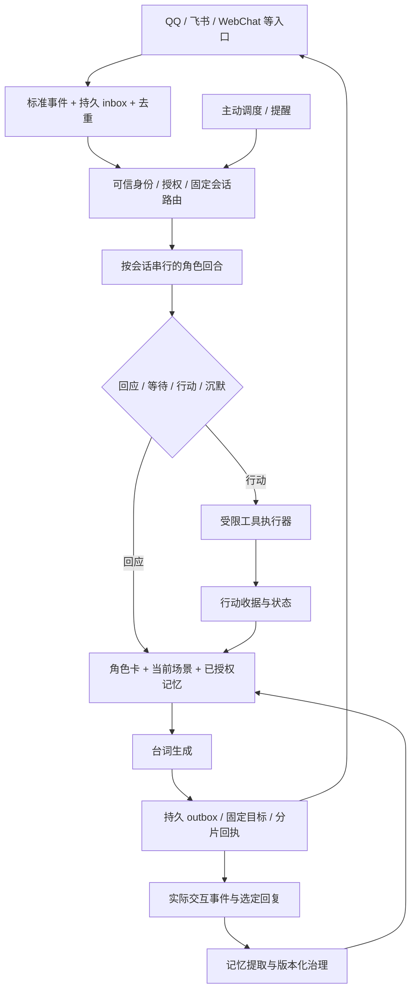

# 角色扮演聊天机器人：框架架构、运维与其他项目综合研究

研究日期：2026-10-22（Asia/Shanghai）。输入：[前期调查报告](10_前期调查报告_聊天机器人与DSH插件生态_2026-10-22.md)。本轮只将该文件作为本地项目背景，没有查看项目文件夹内其他既有内容；研究材料来自上游官方仓库、源码、官方文档与维护者记录。

针对已有 QQ 机器人的改进需求，建议先阅读[00 号导读](00_阅读导读_已有QQ机器人的改进路线.md)。本目录文件名已按推荐阅读顺序编号。

## 1. 先给判断

**建议把 MaiBot 当作社交行为的主要参考，把 AstrBot 当作通用产品底座的优先验证候选；DSH 用于研究可组合运行时和行动能力。记忆先验证作用域、来源和纠错，再决定采用轻量 SQLite 还是 Hindsight 独立服务。**

这不是最终选型或已验证的部署方案。对于“长期像同一个角色”，主要困难是角色身份、共同经历、世界事实和消息交付能否持续一致，功能数量和插件数量不能替代这些判断。

- **自然群友、潜水与接话**：优先读 MaiBot。它对门控、规划、表达和投递的分工最贴近这类需求。
- **自己开发角色产品、多平台与 Web 聊天**：优先验证 AstrBot。已有统一事件流水线、persona、会话管理和部分编辑/重生基础，仍要补角色世界与记忆版本。
- **角色需要工具、长期任务和后台行动**：研究 DSH；NekroAgent 作为代码行动、沙箱与异步委托的深入对照。选一种主运行时，避免一开始就叠多个宿主。
- **单用户伴侣的低复杂度记忆**：先学习 meow-memory 的快照、召回和压缩恢复；用 memory-board 与 DSH-Ling 的治理思想补“用户能看懂并修正”。
- **记忆需要独立服务、时间/实体检索和反思**：再验证 Hindsight。部署时配置身份授权与存储，不把 bank 名称当权限。

以上优先级基于本轮静态研究与目标的契合度，不代表性能、安全或维护成熟度排名。下文与八份独立报告提供证据及边界。

## 2. 重点报告导航

| 独立报告 | 最值得读的内容 | 当前采用判断 |
| --- | --- | --- |
| [02 MaiBot](02_MaiBot_角色行为与群聊架构分析.md) | 发言门控、等待、行为规划、角色表达、A-Memorix 事实治理 | 群友型行为主要参考；剧情分支与角色实例需另建 |
| [03 AstrBot](03_AstrBot_通用聊天底座与运维分析.md) | 多平台流水线、会话锁、persona、WebChat checkpoint、备份与 trace | 通用底座优先验证候选 |
| [04 dsh-meow-memory](04_dsh-meow-memory_分层记忆与恢复分析.md) | SQLite 分层、关键词召回、压缩重注入、dream 与备份 | 轻量闭环主要参考，工作区隔离需升级为角色作用域 |
| [05 Hindsight](05_Hindsight_长期记忆服务分析.md) | retain/recall/reflect、bank、租户扩展、异步任务与存储 | 记忆服务候选，运维复杂度较高 |
| [06 dsh-selfwake](06_dsh-selfwake_主动交流与调度分析.md) | 主动机会、未回复退避、随机间隔、单人桌面路由边界 | 复用调度思想，服务化需定向持久任务 |
| [07 DeepSeek Harness](07_DeepSeek_Harness_插件宿主与运行时分析.md) | Cordis 生命周期、Session/Turn/Step、工具策略、持久化与 schedule | Agent 运行时参考，外加角色产品层 |
| [08 whale-notify](08_whale-notify_渠道整合与身份隔离分析.md) | QQ/飞书到 Agent 的全链、群记忆与 Session、ACL、回复路由 | 桥接样本；多群部署先重做隔离与可靠交付 |
| [09 NekroAgent](09_NekroAgent_行动沙箱与运维分析.md) | 生成代码行动、两类沙箱、RPC、工作区记忆和异步恢复 | 行动层深入对照；先补执行授权边界 |

把插件也列为重点，是因为前期报告最推荐的 whale、selfwake、meow 分别回答“接入、主动性、长期记忆”三个具体问题；不能只比较四个宿主而漏掉它们。

## 3. 对前期报告的更新与收紧

| 原有线索 | 本轮核验后的准确说法 |
| --- | --- |
| 麦麦的心流、记忆与表达 | 当前主链已经是 Maisaka、A-Memorix 和 Host/Runner 插件运行时；应读当前调用链 |
| AstrBot 作为通用底座 | 当前 WebChat 已有末轮编辑、重生和选文子线程；缺口在于它们与长期记忆、剧情 canon、工具副作用的一致性 |
| whale 按群隔离记忆 | 特定召回路径确实按 groupId 过滤，但各群仍可进入同一活跃 Session；不构成全系统隔离 |
| selfwake 逐段生成 | 当前默认先尝试 once 模式，失败再逐段；文档保留较多历史实现说明 |
| meow 兼容性主要到 0.1.5 | README 仍旧，但最新固定提交已含 0.2.x 修复；存在适配证据，尚未实测完整组合 |
| memory-board 页面获取不稳定 | 本轮成功读取 README 和关键源码，可确认文件指纹、备份、临时写入/rename 的实现 |
| 会话切换插件退役 | session-switch、auto-handoff 的归档状态再次确认；不作为新部署默认依赖 |
| Hindsight 的 DSH 格式问题 | 官方 issue #4818 已有 0.8.0 修复说明；本次读到 coding-agents 0.8.2，不能把历史缺陷当现状 |

MaiBot、AstrBot、DSH、whale 等重要技术结论的精确文件引用见各独立报告。meow 的更新可直接核对[本次提交](https://github.com/Phant0Meow/dsh-meow-memory/commit/d531575ef6adaf562e06d49cb84a2c73b66ce6db)，旧会话插件的归档可核对[session-switch](https://github.com/S3K926/dsh-session-switch)与[auto-handoff](https://github.com/S3K926/dsh-auto-handoff)，Hindsight 修复记录见[官方问题 #4818](https://github.com/vectorize-io/hindsight/issues/4818)。

## 4. 其他项目总结

这些对象采用较浅的文档/源码抽查，没有接受与重点对象同等深度的审读。这里的“保留”表示设计参考价值，不表示安装建议。

### 4.1 memory-board：记忆的人工治理面，比又一套检索更有价值

版本 1.3.4，固定提交 963cf514。它把文件档案作为权威数据，通过设置页面提供概览、日记、状态、事件流与搜索；默认只读，明确开启写入后才能编辑。写入核心包括指纹检查、同内容跳过、改前备份、临时文件/rename、写后复核。写前还会再次核对指纹，降低覆盖外部改动的机会。[README](https://github.com/S3K926/dsh-memory-board/blob/963cf514eeb96807f179039e5c786dc14d742f59/README.md)、[写入内核](https://github.com/S3K926/dsh-memory-board/blob/963cf514eeb96807f179039e5c786dc14d742f59/lib/fs-guards.js#L152)。

**参考价值**：角色记忆必须可查看、纠正和追溯。用户应看见“记住了什么、来自哪段对话、改动了什么”，而非只能向模型说“请忘掉”。

**边界**：这是特定文件档案的管理面板，不是通用语义检索器；修改文件本身不会自动撤销已经注入其他会话的旧记忆。当前还包含 boot-tasks 续跑提示，意味着它已涉及运行时状态，不能把它理解成完全被动的文件浏览器。[续跑模块](https://github.com/S3K926/dsh-memory-board/blob/963cf514eeb96807f179039e5c786dc14d742f59/lib/boot-tasks.js)。

### 4.2 DSH-Ling：核心人格受控、表达习惯可变，是值得保留的分层

版本 1.7.1，固定提交 64f47bd6。源码配置包含人格定型、待确认习惯和已接受习惯；README 将契约类身份字段、专用成长通道、记忆树复盘与变更留痕区分。人格组装时会将已接受习惯和待回应建议分别呈现。[人格源码](https://github.com/NightPainters/DSH-Ling/blob/64f47bd6646d842602b8cf4d9b09bbd853b37ae6/lib/host/persona.js)、[项目说明](https://github.com/NightPainters/DSH-Ling/blob/64f47bd6646d842602b8cf4d9b09bbd853b37ae6/README.md)。

**参考价值**：角色的名字、世界观和底线不宜由日常摘要自由改写；表达习惯、关系和经历可以在有证据、可确认、可回滚的范围内变化。这比把所有信息塞进一个不断更新的人格提示更可控。

**边界**：记忆树的“分枝”不能直接当作剧情版本树；要继续核查同一事件修改后派生结论如何失效。定型锁的承诺句强调人工操作，不等于密码学权限。README 还要求为可取证访问日志修改宿主核心，并明确只有该补丁步骤有对应撤法，安装/升级本身没有自动备份回滚；这会增加维护耦合。项目目前仅通过 GitHub/npm 分发，不能只在商店里找它。[安装与回滚边界](https://github.com/NightPainters/DSH-Ling/blob/64f47bd6646d842602b8cf4d9b09bbd853b37ae6/README.md#L218)。

本轮仅抽查人格、守卫、注入模块与文档，未完成记忆树、所有写接口或核心补丁的全链审查。因此保留为人格治理参考，未提升为默认依赖。

### 4.3 QQ-agent：无状态模型轮次与有状态系统的清晰对照

本次 package 版本 0.4.0，固定提交 fdfd325e。README 描述：群消息持续存档，每次由静态人设、摘要和新消息创建独立模型轮次；处理中到来的消息先写档，结束后再处理未读，长期信息通过记忆工具保存。它还有每位群友的可编辑档案。[README](https://github.com/K0nd1us/QQ-agent/blob/fdfd325e148d91845a0aeea3dfdff4cf92fc61a1/README.md)。

**参考价值**：对于高频群聊，可以用事件存储和显式上下文重建控制长会话膨胀。它也证明“模型请求无状态”与“产品没有长期状态”是两件事。

**边界**：README 的成本恒定、工具绑定会话和网络防护属于待源码复核的具体主张，本轮未追完这些实现。成本仍受摘要长度、历史窗口、工具迭代和媒体输入影响，不能引用为本项目性能保证。若后续重点是低成本 QQ 群友，建议将它提升为下一轮源码对照对象。

### 4.4 dafeiyu-qq-bot：实战问题与故障分类的参考集

固定提交 8009d103。README 将 AstrBot 插件集合、QQ—DSH 桥接与控制台等分开列出，并记录群聊引用身份、上下行探针、原始 API 错误泄露、主动交流、情绪与发送策略等问题。[项目说明](https://github.com/nanbengxian-cyber/dafeiyu-qq-bot/blob/8009d1036e5a0a6fa2a2490429375ff4735c5b67/README.md)。

**参考价值**：优先读故障触发条件、根因、修法和回归样本。例如“仍能收群消息”不代表“机器人还能发送”，只监控下行会漏掉上行故障；群聊引用必须按平台用户 ID 判断，不能依昵称。

**边界**：作者的实测数字和完整插件组合未经本轮复现；不能逐个安装后假定独立有效，也不能把 QQ 实践中的昵称、人设或行为规则当通用产品默认值。建议按问题选读，避免将大量单点插件整体搬入。

### 4.5 Kirara AI：工作流与渠道编排的备选

固定提交 36249e4a。README 展示多平台、HTTP API、预设和自定义工作流，适合观察如何把聊天、检索、条件与动作做成可配置流程。[README](https://github.com/lss233/kirara-ai/blob/36249e4a0aa8e3d8930acdfe4e14ec2be6484f63/README.md)。

**参考价值**：当角色活动更像稳定流程，例如入场说明、状态查询、活动报名或资料检索，可视化工作流可能降低改动成本。

**边界**：README 总览列出的平台和详细矩阵状态并不完全一致，部分渠道仍标“重构中”。必须按具体渠道核验，而不能把总览“支持”理解为全能力稳定可用。连续角色动机与剧情关系不是画出流程图就自动获得。本轮未审查调度、持久化和恢复源码。

### 4.6 MoFox-Core：独立分支，适合设计对照，迁移需另做验证

固定提交 61682313。README 明确基于 MaiCore 0.10.0 snapshot.5 独立维护，并提示数据库结构已经变化，直接迁移可能不兼容；同时描述亲和力流、插件事件与拓展记忆。[README](https://github.com/MoFox-Studio/MoFox-Core/blob/61682313b729456da478076919b3fc700d496685/README.md)。

**参考价值**：可以比较不同社交行为与插件扩展方向。**边界**：不能称为当前 MaiBot 的直接增强版，也不能把当前 MaiBot 的源码结论移植到该分支。若要比较体验，应分别固定数据模型、配置与测试情境；本轮不把它排在当前 MaiBot 之前。

### 4.7 deepseekgirl：固定人设与桌面接入样本

固定提交 58178d26。本轮已成功读取 README，补上前期获取失败的空白。作者描述固定鲸鱼娘人设、微信桌面 UI 自动化、QQ 官方机器人与企微接入，并列出限流、熔断、去重、发送超时隔离、看门狗等能力。[README](https://github.com/linxisama/deepseekgirl/blob/58178d26721c50ddb66137182fbaf7e36a2c7f7c/README.md)。

**参考价值**：固定人设产品的装配和桌面自动化故障面。**边界**：作者要求微信窗口可见，提示该渠道依赖桌面状态；需要明确服务保活、用户切窗和控件变化的影响。本轮未验证多端隔离与限流实现。它的固定人设也不是可复用多角色系统；仍没有证据认定它就是“鲸鲸”。

### 4.8 dsh-bili-scroll：信息行动闭环，不能等同完整社交运营

本次 package 为 2.0.0，固定提交 9605fd5b。README 描述搜视频、读取字幕、筛选、日报和可选互动；也记录桌面版自动 headless 执行可能卡住，手动运行作为替代。它还描述对任务开放有限工具、用户修改过的提示词保留并生成 .new 文件等机制。[README](https://github.com/c1overzz/dsh-bili-scroll/blob/9605fd5baf33e1e2ea6d987622fb47304e0adcc3/README.md)、[包版本](https://github.com/c1overzz/dsh-bili-scroll/blob/9605fd5baf33e1e2ea6d987622fb47304e0adcc3/package.json)。

**参考价值**：有边界的后台日常活动、人工配置与默认提示升级的冲突处理。**边界**：README 含多个历史版本说明，不能只根据当前包号判断所有已知问题消失；任务权限与沙箱主张也需要代码和部署验证。它没有给本项目提供已核验的视频制作、剪辑、发布全链，角色闲聊也不应依赖这条外部内容流水线。

### 4.9 退役续聊插件与目录站：保留设计史与发现用途

session-switch、auto-handoff 已归档。旧方案里的“建立新会话、交接包、pending/ack、归档原会话”能说明历史上如何处理连续性，但不应继续当当前默认续航层。值得提炼的是职责收敛：短期上下文用宿主压缩，长期经历用记忆，消息交付另有收据。

Bruce 目录与 1024Store 继续用作发现入口。Bruce 明确收录不等于安全审查或实机兼容；1024 目录包含自动收集和静态格式校验，静态通过也不意味着行为可靠。不同计数口径、子目录与收录方式不能用来排名生态成熟度。[Bruce 声明](https://github.com/bruc3van/awesome-dsh-plugin/blob/ea118a5e7d5358f893f43e662a78b0ef5b4482f9/README.md)、[1024 目录机制](https://github.com/imsai-sh/awesome-deepseek-harness-plugins/blob/ee9924a4e3eb92a272037ad6dc88d02f48a0fb1f/README.md)。

## 5. 面向角色扮演的参考架构

下图是本报告建议的职责结构，不表示必须安装图中所有候选项目。



### 五类状态应有清楚的所有者

| 状态 | 内容 | 推荐边界 |
| --- | --- | --- |
| 角色定义 | 姓名、背景、世界观、语言、硬边界 | 版本化角色卡，授权修改 |
| 当前场景 | 发言人、引用目标、时间、位置、当前议题 | 会话/剧情分支持有 |
| 关系与经历 | 共同事件、承诺、喜好与纠正 | 带来源和可见范围的记忆层 |
| 行动任务 | 工具请求、执行状态、结果与取消 | 独立行动记录，明确副作用 |
| 消息交付 | 入站去重、待发片段、平台回执 | inbox/outbox，不由模型临时推断 |

MaiBot 的规划/表达分离、AstrBot 的事件流水线、DSH 的运行时契约都可映射到这张图；它们是替代或参考关系，不必同时运行。

### 最小身份键与事实语义

建议将渠道来源和角色世界分开标识：

```text
source = platform + account_id + conversation_id + sender_id + message_id
scope  = tenant/user + character_instance + world + story_branch
turn   = input_revision + selected_reply_revision
memory = scope + source_refs + kind + status + supersedes + timestamps
action = scope + operation_id + tool + target + receipt + status
```

不是所有单人原型都要立即建设多租户系统；但即使只有一个用户，也可能有两个角色、两段平行剧情和现实/OOC 信息。应从一开始避免把这些内容混成无来源的“全局用户记忆”。

事实类型至少区分：作者 canon、剧情中已发生事件、角色所知、角色误信、现实用户信息、推测。**检索相关度与记忆真实性分别计算；模型整理出来的结论不能自动升格为角色设定。**

### 编辑、重生和分支的正确关联

编辑旧消息会改变其后生成和记忆的依据。建议记录追加式消息修订：先生成候选，用户接受或规则确认后进入当前剧情；记忆派生物带来源 revision。撤销某节点时，失效关联摘要、事实和关系，再重建受影响部分。对于已发送的外部消息和已完成行动，应保留原收据并进行补偿，不能伪装成从未发生。

AstrBot 的 checkpoint 与子线程是可借鉴起点；MaiBot 的事实账本是来源治理起点；二者都不能直接替代完整剧情版本系统。

## 6. 运维应围绕“故障发生在哪一步”

### 部署复杂度的取舍

- **单人桌面伴侣**：可以从单进程、单角色、SQLite 和明确的本机数据根开始。先做好备份、自动重启后的状态核对和一次通知的冷却。
- **长期社群机器人**：需要稳定接入、按群/私聊路由、流量上限、日志保留、发送回执与恢复演练。多副本不是首要目标。
- **角色带行动或独立记忆服务**：增加容器/工作区、能力授权、任务恢复与多存储一致备份。要有足够需求支撑新增组件的维护成本。

具体系统的持久化位置与恢复边界见各独立报告。尤其注意：MaiBot 不只一个主数据库；AstrBot 的主库不包含所有媒体与索引；Nekro 的业务库、向量库和工作区分开；Hindsight 可能含外部存储；meow 的会话留痕与 homeDir 也需要备份。

### 应记录的指标

| 维度 | 关键问题与记录 |
| --- | --- |
| 接入 | 连接是否存活、最近收信、重复事件、鉴权拒绝 |
| 排队 | 深度、等待时长、丢弃/合并数、单会话锁等待 |
| 行为 | 为什么回复或沉默、主动机会被什么闸门压制 |
| 生成 | 首字时间、全轮时间、错误/重试、模型与工具步数 |
| 记忆 | 写入失败、来源覆盖、错误记忆纠正、召回越界与注入 token |
| 行动 | 排队/执行/完成/取消状态、容器残留、重复副作用 |
| 交付 | 逐片发送、平台回执、部分失败、不确定送达 |
| 恢复 | 备份时间、备份成功与恢复成功、迁移版本、重放记录 |

主链应能串起 message_id → scope → turn_id → tool/action_id → outbound_id。系统认为“模型回答完成”和用户确实收到不是同一指标。**同时检查上行与下行**，避免“还能收消息”掩盖“所有回复都发不出去”。

成本按“有效用户互动、主动回合、记忆整理、外部行动”分别归集。多步工具、摘要、dream 和重试都要计入；本次没有测量 token 费用或给出硬件容量，不能依据源码推算真实吞吐。

### 升级与灾备的最小闭环

1. 固定核心、插件、适配器、模型配置和数据库格式；保存整套可恢复基线。
2. 升级前停止新写入或取得一致快照，备份数据与配置，不只备份代码。
3. 在独立副本恢复并验证迁移，再切换正式实例。
4. 明确代码回退能否读取新数据；不能时用升级前成套快照恢复。
5. 重启后核对未完成任务、待发消息和工具收据，不对所有任务盲目重试。
6. 按实际目标约定可接受数据损失与恢复时间，并用演练测量。本轮没有为任何框架测得这些指标。

## 7. 原型验证顺序

**第一轮只选一个底座、一个角色、一个渠道与一种记忆写入路径。**偏群友体验先验证 MaiBot，偏自行开发的角色产品先验证 AstrBot；若核心需求本来就是工具 Agent，再验证 DSH。这个分流比先安装全部插件更能解释问题来自哪里。

优先验收以下场景：

| 场景 | 通过标准 |
| --- | --- |
| 两用户同名、群/私聊交错、两个角色并行 | 身份、记忆、回复目标分别正确 |
| 连续插话、引用他人、工具中追问 | 目标准确、无重复消费、顺序可解释 |
| 自发发言后用户不回 | 退避与日预算有效；用户发话立即止住剩余主动段 |
| 用户扮演与现实自述混合 | 虚构设定不进入现实档案，OOC 指令归属明确 |
| 纠正事实、编辑旧消息、重生与分支 | 派生记忆按 revision 失效，未选回复不固化 |
| 模型失败、工具超时、取消 | 已完成与未完成行动分清，不重复副作用 |
| 分条第1条成功、第2条失败 | 不盲目重发全部；每片状态可核对 |
| 发送后立即崩溃、平台重投、重复启动 | 去重和恢复符合明确语义 |
| 压缩失败、整理中断、热重载 | 不反复整理、不永久卡住、不换错会话 |
| 从备份恢复到新数据根 | 角色、历史、附件、记忆、任务及配置彼此对应 |

只有在这些基础行为可解释之后，再比较更自然的发言节奏、复杂反思、向量召回和多 Agent 协作。后续验证也不等于要求立刻实现整张参考架构。

## 8. 证据范围与阅读方式

本轮主要采用静态源码阅读，而非重新收集社交平台演示。重要对象均固定实际读取的 commit；版本字段只表示该源码快照的声明，不保证同名发布包内容完全一致。没有安装上游依赖、执行上游脚本、接入聊天账号或做性能、安全攻击及灾备实测。

正文中的确定实现、维护者主张、静态风险推导和本报告建议已分别说明。报告里的“验收清单”是后续验证方法，不是已经通过的结果。建议先读第1—3节，再按需要进入独立报告；第4节覆盖其他全部推荐与次级线索。

## 附：本轮仓库快照清单

下表记录实际读取的固定提交。它们是可追溯阅读锚点，不代表发行包校验、兼容矩阵或运行认证；重点与次级对象的研究深度不同。

| 对象 | 固定提交 | 本轮覆盖 |
| --- | --- | --- |
| MaiBot | [`c602a2780f4f`](https://github.com/Mai-with-u/MaiBot/commit/c602a2780f4f4dda4a6be46d67abc1cfb1ad420c) | 重点：源码调用链 |
| AstrBot | [`0cd42bd4dd21`](https://github.com/AstrBotDevs/AstrBot/commit/0cd42bd4dd216d8810da4e3f5fb2e381d3c6817e) | 重点：源码调用链 |
| DeepSeek Harness | [`687f282e8625`](https://github.com/deepseek-ai/deepseek-harness/commit/687f282e8625c6b8d11ff58211a90524be2e4317) | 重点：源码与固定仓库文档 |
| whale-notify | [`531e73a50d73`](https://github.com/Mochabafey/whale-notify/commit/531e73a50d734532f100649422526a836fe9215f) | 重点：源码调用链 |
| NekroAgent | [`ea7b90eb83bd`](https://github.com/KroMiose/nekro-agent/commit/ea7b90eb83bd80061b2a177510c27c957f7f980d) | 重点：源码调用链 |
| Hindsight | [`517192d3bfef`](https://github.com/vectorize-io/hindsight/commit/517192d3bfef0bd7b3efcdedc7829445a55c3ae9) | 重点：源码与固定仓库文档 |
| dsh-selfwake | [`4ec7c8107797`](https://github.com/S3K926/dsh-selfwake/commit/4ec7c81077974bc0595e18e9fcc4276acaf2f9bf) | 重点：源码调用链 |
| dsh-meow-memory | [`d531575ef6ad`](https://github.com/Phant0Meow/dsh-meow-memory/commit/d531575ef6adaf562e06d49cb84a2c73b66ce6db) | 重点：源码调用链 |
| dsh-memory-board | [`963cf514eeb9`](https://github.com/S3K926/dsh-memory-board/commit/963cf514eeb96807f179039e5c786dc14d742f59) | README 与文件写入/续跑源码抽查 |
| DSH-Ling | [`64f47bd6646d`](https://github.com/NightPainters/DSH-Ling/commit/64f47bd6646d842602b8cf4d9b09bbd853b37ae6) | README 与人格/守卫/注入源码抽查 |
| QQ-agent | [`fdfd325e148d`](https://github.com/K0nd1us/QQ-agent/commit/fdfd325e148d91845a0aeea3dfdff4cf92fc61a1) | README、包清单 |
| dafeiyu-qq-bot | [`8009d1036e5a`](https://github.com/nanbengxian-cyber/dafeiyu-qq-bot/commit/8009d1036e5a0a6fa2a2490429375ff4735c5b67) | README、目录定位 |
| Kirara AI | [`36249e4a0aa8`](https://github.com/lss233/kirara-ai/commit/36249e4a0aa8e3d8930acdfe4e14ec2be6484f63) | README 与渠道矩阵 |
| MoFox-Core | [`61682313b729`](https://github.com/MoFox-Studio/MoFox-Core/commit/61682313b729456da478076919b3fc700d496685) | README 与分支/迁移说明 |
| deepseekgirl | [`58178d26721c`](https://github.com/linxisama/deepseekgirl/commit/58178d26721c50ddb66137182fbaf7e36a2c7f7c) | README |
| dsh-bili-scroll | [`9605fd5baf33`](https://github.com/c1overzz/dsh-bili-scroll/commit/9605fd5baf33e1e2ea6d987622fb47304e0adcc3) | README、包清单 |
| dsh-session-switch | [`aa0f47d19e68`](https://github.com/S3K926/dsh-session-switch/commit/aa0f47d19e684d29033dd7440b23542cd5fd39c7) | 归档状态、README |
| dsh-auto-handoff | [`3b68f3befc8e`](https://github.com/S3K926/dsh-auto-handoff/commit/3b68f3befc8e05ee933166f187724462002e72a1) | 归档状态、README |
| Bruce 目录 | [`ea118a5e7d53`](https://github.com/bruc3van/awesome-dsh-plugin/commit/ea118a5e7d5358f893f43e662a78b0ef5b4482f9) | README、订阅与核验范围声明 |
| 1024 目录 | [`ee9924a4e3eb`](https://github.com/imsai-sh/awesome-deepseek-harness-plugins/commit/ee9924a4e3eb92a272037ad6dc88d02f48a0fb1f) | README、目录发现机制说明 |

