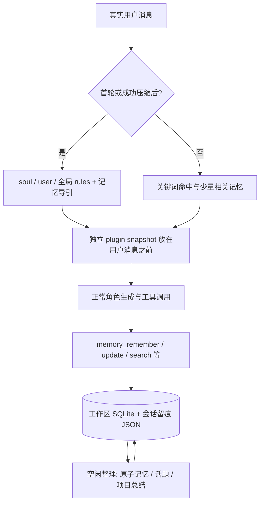

# dsh-meow-memory：轻量分层记忆与角色扮演适配分析

核验日期：2026-10-22（Asia/Shanghai）。对象：[Phant0Meow/dsh-meow-memory](https://github.com/Phant0Meow/dsh-meow-memory)。固定快照：`main@d531575ef6adaf562e06d49cb84a2c73b66ce6db`，package.json 版本 `0.31.1`。本次审读数据库、检索、注入、整理、工具与路由鉴权源码及设计文档，未安装、运行或进行召回评测。

## 1. 判断：最值得先研究的轻量记忆实现，但隔离模型要改

它提供了一个容易读懂的闭环：SQLite 分类存储 → 首轮稳定身份快照 → 每轮小规模相关召回 → 压缩后重注入 → 闲时整理。它适合研究个人角色伴侣如何在有限上下文中保持连续性，也适合先用简单存储验证记忆规则。

关键限制是：**数据库主要按工作区定位，soul/user 是该库中的共享类别，session_id 主要承担来源与注入留痕。它不是面向多用户、多角色、剧情分支的权限和事实系统。**将不同用户或角色放在同一工作区，不能只靠 project 字段避免串记忆。

前期报告引用的 README 兼容性仍停留在 DSH 0.1.5；但本次固定提交明确修复了 0.2.x 的旧格式轮次折叠和注入横条。正确表述是“已有较新适配代码与修复证据，具体宿主组合仍需实测”，不能说完全不支持 0.2.x，也不能说所有新版本必然兼容。[本次提交](https://github.com/Phant0Meow/dsh-meow-memory/commit/d531575ef6adaf562e06d49cb84a2c73b66ce6db)、[兼容性声明](https://github.com/Phant0Meow/dsh-meow-memory/blob/d531575ef6adaf562e06d49cb84a2c73b66ce6db/README.md#L65)。

## 2. 数据流：稳定快照与按需召回分工清楚



入口在 `agent/pre-step` 中先取得宿主 decision，再做注入；仅插件逻辑出错时放行原始 decision，宿主本身的错误仍然上抛。这个边界值得借鉴：记忆故障可以降级聊天，但不能把宿主取消或模型错误吞掉。文中“真实用户消息”沿用源码命名，实际以 `source.kind === 'user'` 判定，并非不可伪造的人类来源证明；selfwake 也使用这个值，其主动注入可能进入这里的用户消息链路。[注入入口及降级](https://github.com/Phant0Meow/dsh-meow-memory/blob/d531575ef6adaf562e06d49cb84a2c73b66ce6db/src/index.ts#L1349)。

### 首轮：常驻身份，不等于所有历史都放进 prompt

首轮快照直接读取全部 active soul、user，以及全局且 importance≥2 的 rules，再提供项目导引。实际正文是一条独立的 plugin snapshot，不改写用户原消息，有利于保持用户输入、会话标题与检索数据的边界。

这里的“首轮快照”仍有膨胀风险：soul/user 正文没有统一硬 token 上限。对于角色伴侣，必须限制核心画像大小，否则记忆积累会持续抬高每轮上下文开销。[快照构造](https://github.com/Phant0Meow/dsh-meow-memory/blob/d531575ef6adaf562e06d49cb84a2c73b66ce6db/src/inject.ts#L250)。

### 后续轮：关键词检索与已见记录

检索层包含 CJK 相邻 bigram、Unicode 字母数字整词、NFKC 归一化；英文额外做停用词和词干处理。显式搜索使用 BM25、近期权重等；自动命中也使用关键词相关度等信号。它没有依赖远程 embedding 服务。

因此，其优点是依赖少、容易解释命中原因；不足是别名、代词、跨语言与“语义相近但没有共同词”的经历未必召回。**BM25 分数是相关度，不能作为记忆真实性或人物关系的置信度。**[分词与检索实现](https://github.com/Phant0Meow/dsh-meow-memory/blob/d531575ef6adaf562e06d49cb84a2c73b66ce6db/src/bm25.ts)。

会话 JSON 记录 injected、searched、accessed、written、projectsQueried 和当前 project。这个设计能回答“这条经历是否已经展示给当前会话”，有利于减少重复；它不承担对其他用户的访问授权。[会话留痕](https://github.com/Phant0Meow/dsh-meow-memory/blob/d531575ef6adaf562e06d49cb84a2c73b66ce6db/src/inject.ts#L28)。

### 压缩：成功后重建，而不是猜测模型还记得什么

收到压缩 start/summary 时释放已见集合；成功的 compaction/end 标记待重注入。下一条真实用户消息重新装入快照、已查阅项目与相关写入记忆；失败的 end 不设置此标记。这种显式生命周期比“上下文快满了就另开聊天”更清楚。[压缩处理](https://github.com/Phant0Meow/dsh-meow-memory/blob/d531575ef6adaf562e06d49cb84a2c73b66ce6db/src/index.ts#L1244)。

但重注入仍是根据数据库重建上下文，并不自动保证剧情连续、原话完整或所有旧记忆都被召回。

## 3. 七类记忆：分类有价值，角色世界还需要第二组维度

| 原类别 | 适合借鉴的用途 | 角色扮演需要补充 |
| --- | --- | --- |
| soul | 相对稳定的自我描述 | 绑定 character_id，核心设定由受控角色卡提供 |
| user | 对用户的认识 | 绑定真实用户/参与者；区分现实用户与扮演人物 |
| project | 某项共同活动或目标 | 用作剧情/活动索引，不能代替访问控制 |
| fact | 已知事实 | 标明现实、虚构世界、传闻或模型推测 |
| lesson | 纠正与经验 | 保存原始证据、旧值与纠正者 |
| topic | 持续话题及目标 | 绑定剧情分支、阶段和待解决冲突 |
| rules | 行为准则 | 只有授权来源可提升为长期规则 |

数据库记录了 source_session、created_at、updated_at、status 等，但没有完整的 tenant_id、character_id、participant_id、branch_id 和事实世界类型。[数据结构](https://github.com/Phant0Meow/dsh-meow-memory/blob/d531575ef6adaf562e06d49cb84a2c73b66ce6db/src/db.ts#L129)。

建议至少增加：

```text
scope = tenant + character + conversation/audience + story_branch
memory = content + kind + source_message_ids + confidence
         + valid_from/to + canon_version + supersedes + status
```

这是本报告建议的数据模型。它处理两个原插件分类不能单独解决的问题：

1. “我在剧中是吸血鬼”不应覆盖现实用户信息；同一句内容在不同世界有不同真值。
2. 用户重生回复或删掉剧情节点后，派生摘要和人物关系不能继续使用被撤销的事件。

优先把核心角色卡、可变关系、共同经历、现实用户资料分开维护，再决定是否需要向量库。

## 4. Dream 整理：可学的是租约与范围，需防推测变设定

当前实现默认窗口空闲约 180 分钟后允许整理，检查周期约 15 分钟，按固定时区时段抑制新任务；手动整理不受抑制。整理分原子记忆、topic、项目总结，范围包括该窗口创建和接触过的记忆。**这些默认时段只是插件策略，不能当作任何模型供应商当前定价规则。**[默认配置](https://github.com/Phant0Meow/dsh-meow-memory/blob/d531575ef6adaf562e06d49cb84a2c73b66ce6db/src/defaults.ts#L23)、[整理范围](https://github.com/Phant0Meow/dsh-meow-memory/blob/d531575ef6adaf562e06d49cb84a2c73b66ce6db/src/dream.ts#L112)。

值得借鉴的工程细节：

- SQLite 中的检查节流与 dream_owner、进度时间等租约字段，减少跨实例重复启动，并支持中断收尾。
- 插件自身整理轮不刷新窗口活跃时间，避免“因为整理而变活跃，再整理”的循环。
- 当前整理通过主窗口 steer 执行；需要换模型时按请求覆盖，减少切换后遗留全局模型状态的机会。

这些机制只解决调度和恢复的一部分。代码仍有“冲突判断由模型参考时间戳、工具层乐观锁待迭代”的说明；不能把租约理解为每条记忆的并发版本控制。[租约字段与抢占](https://github.com/Phant0Meow/dsh-meow-memory/blob/d531575ef6adaf562e06d49cb84a2c73b66ce6db/src/db.ts#L531)、[整理实现边界](https://github.com/Phant0Meow/dsh-meow-memory/blob/d531575ef6adaf562e06d49cb84a2c73b66ce6db/src/dream.ts#L23)。

角色扮演建议：dream 只生成整理建议或新版本，先保留旧证据；不能自行把“用户一次玩笑”变为稳定喜好，也不能自动改掉角色核心身份。每次归并应保存来源、旧值、新值、操作理由和批次 ID，支持按批次回滚。

## 5. 隔离与接口：工作区和鉴权各解决不同问题

数据库位置为 `<workspace>/<projectDir>/memory.db`，默认 projectDir 为 .dsh-meow。同工作区的 soul/user 会进入同库快照；memory_read 按 ID 从当前工作区库读取，project 过滤不是全链路 ACL。多用户服务应在所有工具和检索入口施加 scope 校验，不能让模型决定自己所属角色或可访问的 project。[数据库定位](https://github.com/Phant0Meow/dsh-meow-memory/blob/d531575ef6adaf562e06d49cb84a2c73b66ce6db/src/db.ts#L199)、[读取工具](https://github.com/Phant0Meow/dsh-meow-memory/blob/d531575ef6adaf562e06d49cb84a2c73b66ce6db/src/tools.ts#L617)。

插件已有 auth-gate：较新宿主使用 connection.requestRejection，connection 存在但没有该方法时回退 Host/Origin fence，connection 服务整个缺失时返回 503。它修补了插件直注册路由可能绕开宿主鉴权的问题，是值得学习的“扩展路由也要走统一闸门”实践；旧版 fence 与应用层逐用户权限仍不是一回事。[路由鉴权](https://github.com/Phant0Meow/dsh-meow-memory/blob/d531575ef6adaf562e06d49cb84a2c73b66ce6db/src/auth-gate.ts)。

## 6. 运维：备份必须覆盖数据库之外的状态

| 对象 | 本次实现 | 运维要求 |
| --- | --- | --- |
| SQLite | WAL，busy_timeout 5000ms，同步数据库 API | 监控锁等待与事件循环延迟；不把多个进程可打开等同无限并发 |
| 库备份 | 可选 VACUUM INTO，一份 memory.db.bak，默认关闭 | 显式开启后仍需独立保留多代备份和恢复演练 |
| 会话留痕 | 工作区 sessions 下的 JSON | 与数据库同步备份，防恢复后注入/重建范围失配 |
| 全局目录 | 默认用户主目录 .dsh-meow，可配置/切换 | 备份 window-index、prompt 覆盖、迁移状态及目录指针 |
| 宿主数据 | DSH 会话事件、插件配置等 | 用于追溯 source_session；不能只恢复记忆库 |

`backupMemoryDb` 考虑了 WAL 修改时间，以 VACUUM INTO 写临时文件后 rename，优于直接复制仍在写的主库。但它只有单份轮转、失败返回 false、且默认关闭；**这不是完整灾备策略。**[备份实现](https://github.com/Phant0Meow/dsh-meow-memory/blob/d531575ef6adaf562e06d49cb84a2c73b66ce6db/src/db.ts#L819)、[homeDir 与目录指针](https://github.com/Phant0Meow/dsh-meow-memory/blob/d531575ef6adaf562e06d49cb84a2c73b66ce6db/src/home-dir.ts)。

升级前固定宿主、插件 commit 和配置；复制一份数据做迁移验证，检查 Node 内置 SQLite 能力、插件是否真正激活、注入是否在正确位置。回滚二进制前确认数据库迁移能否回退，必要时恢复同一批次的数据库、会话状态和配置。

## 7. 应先验证的场景

1. 两个用户、两个角色在同一工作区聊天，使用相同关键词与可猜测记忆 ID，确保不能互读。
2. 用户引用“不要这样做”或扮演反派时，不会被整理成自己的行为准则。
3. 一条事实纠正后，搜索、首轮快照、压缩重注入与 dream 都使用正确版本。
4. 重生/删除剧情节点后，原节点衍生关系与总结都失效；其他分支保持原状。
5. 自动压缩失败、中途取消或模型失败后，不出现重复整理或永久租约。
6. WAL 写入中执行备份并恢复，核对条目、来源、留痕和窗口索引。
7. 角色卡和 user 画像逐渐变大时，测量实际注入 token、召回命中率与误记率。
8. 与 selfwake/whale 同开时，合成主动消息不会被当作人类活动，也不会把内部整理内容发给群聊。

本次没有执行这些测试。优先级应是“隔离正确、纠错有效、恢复可验证”，再优化召回数量和自动整理频率。

## 8. 阅读地图与采用建议

推荐按 `db.ts → inject.ts → index.ts 的 pre-step/compaction → tools.ts → dream.ts → auth-gate.ts` 阅读；之后再看客户端折叠。UI 隐藏了整理轮，不意味着这些轮从主会话日志或模型上下文中消失。

若目标先是单用户、单角色：借鉴 SQLite、来源留痕、首轮快照和压缩重注入即可，自动 dream 可后开。若目标是多用户产品：先完成强制 scope、版本化记忆和撤销派生物，再接自动整理。需要更复杂的时间检索、实体关系与独立服务时，再对照 Hindsight 的报告。

