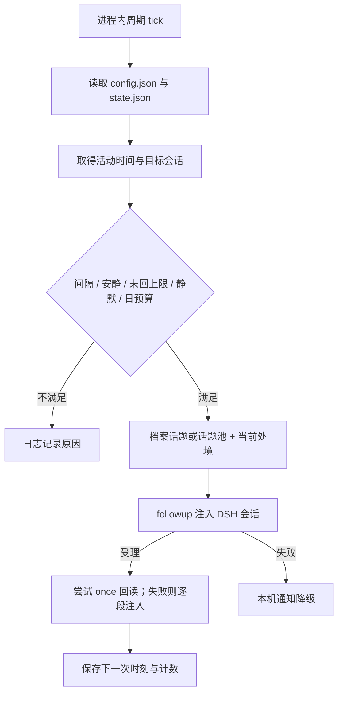

# dsh-selfwake：主动交流调度与故障边界分析

核验日期：2026-10-22（Asia/Shanghai）。对象：[S3K926/dsh-selfwake](https://github.com/S3K926/dsh-selfwake)。固定版本：`main@4ec7c81077974bc0595e18e9fcc4276acaf2f9bf`，包版本 `0.1.5`。本报告阅读了 README、入口源码、更新记录与 once-mode 测试文件，未安装、运行或连接聊天账号。

## 1. 判断：优先借鉴调度思想，原实现适合单人桌面伴侣

这个插件把“创造开口机会”与“生成角色台词”分开，且保留未回复退避、安静时段、每日预算、可解释的随机间隔。这些机制对角色陪伴很有价值。

但它的调度目标是“最近活动的 DSH 会话”，状态也是实例级文件；它没有提供角色、用户、群、剧情分支共同构成的强制调度键。**适合作为主动交流的设计样本；多角色、多群服务应另建按会话隔离的调度器。**

还有一个需要纠正前期印象的细节：当前默认 `deliverMode: once`，会尝试一次生成多句；读取失败再退回逐段注入。README 较多篇幅描述的是此前逐段方案，源码默认值更能代表本次快照。[默认配置与版本](https://github.com/S3K926/dsh-selfwake/blob/4ec7c81077974bc0595e18e9fcc4276acaf2f9bf/index.js#L34)、[package.json](https://github.com/S3K926/dsh-selfwake/blob/4ec7c81077974bc0595e18e9fcc4276acaf2f9bf/package.json)。

## 2. 实际运行链路

入口依赖 Cordis 的 timer、agents 服务。tick 使用 `ctx.interval`；投递通过 agents.get 找到句柄，再调用 followup，缺少时尝试 send。消息采用 `role: user`、`source.kind: user`，并用零宽字符及历史文本标记识别自己的注入。[入口与投递](https://github.com/S3K926/dsh-selfwake/blob/4ec7c81077974bc0595e18e9fcc4276acaf2f9bf/index.js#L1089)。

这说明它借用了正常用户消息链路来驱动生成。它不应成为系统鉴别人类活动的依据；其他插件也必须能区分这些合成消息。

### 五道闸值得复用，参数需要按产品重新定

| 机制 | 本次源码行为 | 对角色扮演的意义 |
| --- | --- | --- |
| 间隔退避 | 基础间隔随连续未回复次数放大，放大有上限；下一次时刻落盘 | 无回应时减少打扰 |
| 可复现抖动 | 以 session、轮次等构造 hash，避免每次 tick 重摇 | 可以解释为什么此时触发，便于回放 |
| 安静判断 | 优先读真实 user/message；安静阈值还有约 ±20% 抖动 | 避免总在固定分钟开口 |
| 未回上限 | 默认 3 次；发现较新的用户活动清零 | 支持拒绝互动与冷却 |
| 静默与日预算 | 默认 0—7 点静默、每日 12 次；0 次预算表示不限 | 为渠道和用户保留硬限额 |

这是**代码中的默认配置**，并非推荐上线参数。生成模式下，首条注入被 followup/send 接口受理的路径还会附加回合冷却；这里的 delivered.ok 不证明模型生成完成或渠道送达。不能只按 README 的“基准间隔乘退避”估算实际频率。[闸门](https://github.com/S3K926/dsh-selfwake/blob/4ec7c81077974bc0595e18e9fcc4276acaf2f9bf/index.js#L423)、[下次时刻计算与保存](https://github.com/S3K926/dsh-selfwake/blob/4ec7c81077974bc0595e18e9fcc4276acaf2f9bf/index.js#L1346)。

### 内容生成：共享处境，避免同一回合自相矛盾

插件从档案中的待办或最近日记寻找话题，失败时用内置池。一个回合先计算一次处境，再交给若干段共享；这是值得保留的状态快照思想。分段前还会重新检查用户是否说话，避免用户接话后继续机械追加。

对角色扮演，需要区分“角色世界中的行动”和“现实发生的行动”。例如角色可以在虚构剧情中喝茶，但不应把拟态台词写成已经执行的现实工具结果。建议将状态明确拆成 `fictional_state`、`observed_real_event` 与 `executed_action_result`，并由生成器明确选择使用范围。这是本报告建议，原插件没有完整实现这套类型体系。

## 3. 源码揭示的边界

以下是静态控制流观察，尚未通过运行复现；不能据此给出发生概率。

### 3.1 最近写入的会话，不等于应收到主动消息的会话

`findLatestSessionId` 扫目录与文件 mtime 选最新会话；`deliverToSession` 每次都会重新选择目标。分段循环虽然保留了最初 sessionId 检查用户活动，真正投递时却再次调用该选择函数。**用户切换会话或其他 agent 写日志后，后续段可能被送到另一个会话。**这在多角色或多群环境下尤其不适合照搬。[目标选择](https://github.com/S3K926/dsh-selfwake/blob/4ec7c81077974bc0595e18e9fcc4276acaf2f9bf/index.js#L483)、[分段循环](https://github.com/S3K926/dsh-selfwake/blob/4ec7c81077974bc0595e18e9fcc4276acaf2f9bf/index.js#L1291)。

建议创建主动事件时固定 `conversation_id + character_id + audience_id + branch_id`，后续所有步骤只使用该路由键。

### 3.2 人类活动识别存在 mtime 回退

正常路径会跳过 selfwake 注入，读取最近 user/message。拿不到真实活动时间时，tick 仍会退回文件 mtime。因此 README 所述“不使用 mtime”不能理解为所有路径的保证。未知活动时间时闸门会保守不开，但拿到的 mtime 若来自后台操作，仍可能影响安静判断和未回复计数。[真实活动识别](https://github.com/S3K926/dsh-selfwake/blob/4ec7c81077974bc0595e18e9fcc4276acaf2f9bf/index.js#L160)、[tick 回退](https://github.com/S3K926/dsh-selfwake/blob/4ec7c81077974bc0595e18e9fcc4276acaf2f9bf/index.js#L1206)。

建议采用结构化来源字段：human、scheduler、memory-maintenance、tool，并分别记录 last_human_at、last_assistant_at、last_background_at。

### 3.3 降级通知与旧模式，没有经过后面的状态保存

源码在“非生成模式”或“投递失败”时提前 return，而 nextAllowedAt、每日次数、unanswered 的保存位于其后。由此推断：这些分支本身没有推进冷却和预算；若其他闸门持续满足，可能在后续 tick 重试甚至重复通知。**需要专门验证通知成功但会话不可用这一场景。**[提前返回](https://github.com/S3K926/dsh-selfwake/blob/4ec7c81077974bc0595e18e9fcc4276acaf2f9bf/index.js#L1273)、[状态保存位置](https://github.com/S3K926/dsh-selfwake/blob/4ec7c81077974bc0595e18e9fcc4276acaf2f9bf/index.js#L1351)。

建议把“触发尝试”“模型生成成功”“渠道送达”分开计数；任何已经造成用户可见通知的结果，都推进对应冷却。

### 3.4 本地文件与内存锁不构成持久任务队列

state.json 使用直接 writeFileSync，读坏 JSON 回落默认状态；roundActive 是单进程变量。源码未提供跨实例抢占、任务租约与发送回执事务。插件退出钩子停止 interval，但分段 timeout/等待没有在该钩子中统一取消，升级和停用时应验证残留任务行为。[读写状态](https://github.com/S3K926/dsh-selfwake/blob/4ec7c81077974bc0595e18e9fcc4276acaf2f9bf/index.js#L118)、[生命周期收尾](https://github.com/S3K926/dsh-selfwake/blob/4ec7c81077974bc0595e18e9fcc4276acaf2f9bf/index.js#L1382)。

对服务部署，建议状态机为：scheduled → claimed → generating → ready → sent / suppressed / failed，使用唯一事件 ID、租约与 outbox。进程重启后恢复未完成事件，恢复时重新校验用户活动与静默时间。

## 4. 可复用的模块边界

| 模块 | 输入 | 输出与职责 |
| --- | --- | --- |
| 调度策略 | 用户偏好、最近活动、日预算、关系阶段 | 一次候选开口事件及原因 |
| 内容规划 | 可信共同经历、角色设定、剧情状态 | 话题意图，可选择放弃 |
| 台词生成 | 已固定的角色和受众上下文 | 待发送正文，不能选择渠道身份 |
| 渠道出口 | 路由键、事件 ID、正文 | 去重、限频、回执、重试 |
| 记忆写入 | 确实送达的台词与用户回应 | 来源明确的经历，避免把计划当事实 |

selfwake 最值得借鉴前两项的拆分。渠道出口和持久化调度需要由聊天系统统一负责，避免与 whale 定时汇报或其他主动插件分别触发同一件事。

## 5. 运维建议与验收场景

- **持久化范围**：保存 stateDir 下状态、热配置与日志，以及话题池和档案根配置；不要只备份插件代码。
- **时区**：闸门使用本机 Date.getHours 与日键，部署时显式记录进程时区；服务迁移后验证跨午夜和日预算清零。
- **故障退避**：模型失败、会话不可用与通知失败分别退避；不要以“每分钟检查”替代失败策略。
- **成本观测**：记录一次主动回合触发了几次模型请求。once 失败后逐段回退会增加请求，不能把一次开口等同一次调用。
- **配置与脚本**：notifyScript 仅认启动配置，热配置明确删掉该字段；通知执行使用同步 PowerShell 子进程，超时最多 20 秒，会占住 Node 事件循环，长期服务宜改异步受控任务。[通知执行](https://github.com/S3K926/dsh-selfwake/blob/4ec7c81077974bc0595e18e9fcc4276acaf2f9bf/index.js#L467)。
- **指标**：按原因统计 suppressed、triggered、generation_failed、delivery_failed、delivered，并记录目标 ID、上次人类活动、预算、nextAllowedAt；正文日志应支持最小化与清理。

优先验收：① 用户发话后剩余段能停止；② 生成中切换角色窗口不串台；③ DSH 活着但目标 agent 不活跃时只产生受限通知；④ 两实例启动不会双发；⑤ 保存失败或坏 JSON 不突破日预算；⑥ 23—7 点静默配置跨午夜正确；⑦ once 回读失败不会重复发送正文；⑧ 热重载后旧 timeout 不继续投递。

本次未执行上述验收。它们决定这套思路能否从个人桌面样本转为可维护的角色聊天服务。

## 6. 源码阅读顺序

先读 DEFAULTS 与 evaluateGates，再读 realUserActivityMs、findLatestSessionId 和 deliverToSession，最后追 tick、tryDeliverOnce、分段回退与状态落盘。不要只看 README 中的历史“真机验收”：那是作者对特定版本的记录，不等于本次快照的独立测试结果。

